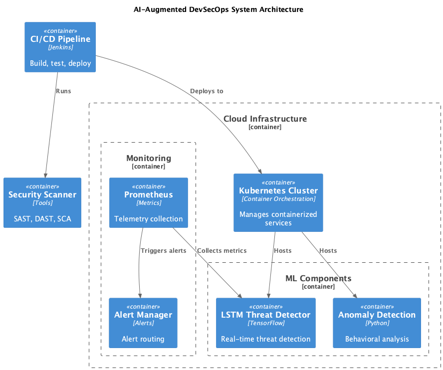

# AI-Augmented DevSecOps Framework

[](https://choosealicense.com/licenses/mit/)
[](https://www.python.org/downloads/)
[](https://github.com/Ayush-Singh986/ai-devsecops-framework)

An AI-enhanced security automation framework for cloud-native applications, featuring real-time threat detection and automated response capabilities. This implementation accompanies the IEEE SOSE 2025 paper: **"AI-Augmented DevSecOps Pipelines for Secure and Scalable Service-Oriented Architectures in Cloud-Native Systems"**.

For a beginner-friendly explanation of the project, start with [README_PROJECT_EXPLAINED.md](README_PROJECT_EXPLAINED.md). For a file-by-file walkthrough, current implementation status, setup/deployment notes, and interview/resume preparation, see [README_INTERVIEW.md](README_INTERVIEW.md).

## 🎯 Key Achievements

- **95% attack detection rate** with sub-2 second latency
- **98% accuracy retention** over 6 months with adaptive training
- **10,000 events/sec** throughput with optimized processing
- **Complete open-source implementation** with reproducible results

## 🚀 Features

### Core AI Components
- **LSTM Threat Detection Engine**: 64-unit architecture with sliding window analysis
- **Zero-Day Behavioral Analysis**: Isolation Forest with 25+ behavioral indicators  
- **Security Orchestrator**: Confidence-weighted conflict resolution
- **API Security Validator**: BOLA detection and fuzzing capabilities
- **Business Logic Validator**: Race condition and state violation detection

### Integration & Deployment
- **Kubernetes Native**: NetworkPolicy generation and pod isolation
- **CI/CD Integration**: Jenkins pipeline with security gates
- **Prometheus Monitoring**: Custom metrics and alerting
- **Helm Charts**: Production-ready deployment
- **Terraform Infrastructure**: Complete IaC setup

## 📊 Performance Benchmarks

| System | Precision | Recall | Latency(s) | Throughput(eps) | Resource Efficiency |
|--------|-----------|--------|------------|-----------------|-------------------|
| **Our Framework** | **0.95±0.02** | **0.94±0.03** | **1.5±0.2** | **10K** | **33% less CPU** |
| Suricata 6.0.9 | 0.88±0.04 | 0.85±0.05 | 2.3±0.3 | 8K | Baseline |
| Prisma Cloud 22.12 | 0.92±0.02 | 0.89±0.03 | 1.9±0.3 | 9K | 16% more CPU |

*Statistical significance: p < 0.05, 95% confidence intervals*

## 🏗 Architecture

### System Architecture



*This diagram shows the proposed component relationships. The repository is a prototype; some components and end-to-end connections are incomplete.*

## 📋 Prerequisites

- **Python 3.8+** with asyncio support
- **Docker 20.10+** and Docker Compose
- **Kubernetes 1.19+** cluster access
- **Jenkins 2.3x+** for CI/CD integration
- **Prometheus 2.30+** for monitoring
- **Helm 3.x+** for deployment
- **Terraform 1.0+** for infrastructure

**Hardware Requirements:**
- CPU: 8+ cores (Intel/AMD x64)
- RAM: 16+ GB
- Storage: 100+ GB SSD
- GPU: Optional (NVIDIA Tesla V100 recommended)

## 🚀 Quick Start

### 1. Clone and Setup

```bash
git clone https://github.com/Ayush-Singh986/ai-devsecops-framework.git
cd ai-devsecops-framework

# Create virtual environment
python -m venv venv
source venv/bin/activate  # On Windows: venv\Scripts\activate

# Install dependencies
pip install -r requirements.txt
```

### 2. Configuration

```bash
# Copy example configuration
cp config/settings.yaml.example config/settings.yaml

# Edit configuration for your environment
vim config/settings.yaml
```

### 3. Deploy Infrastructure

```bash
# Deploy with Terraform
cd terraform/
terraform init
terraform plan
terraform apply

# Deploy with Helm
cd ../helm/
helm install ai-devsecops ./ai-devsecops-framework

# Or deploy with kubectl
kubectl apply -f deploy/kubernetes/
```

### 4. Start Services

```bash
# Development environment
docker-compose -f docker-compose.dev.yml up -d

# Production environment
docker-compose up -d

# Verify deployment
kubectl get pods -l app=ai-devsecops
```

## 💻 Usage Examples

### Basic Framework Usage

```python
from src.main import AIDevSecOpsFramework
import asyncio

async def main():
    # Initialize framework
    framework = AIDevSecOpsFramework()
    
    # Start monitoring
    await framework.start_monitoring()
    
    # Process security event
    event = {
        "timestamp": time.time(),
        "event_type": "api_call",
        "source_ip": "192.168.1.100",
        "endpoint": "/api/admin/users",
        "method": "GET"
    }
    
    result = await framework.process_event(event)
    print(f"Threat detected: {result['is_threat']}")
    print(f"Confidence: {result['confidence']:.2f}")
    print(f"Processing time: {result['processing_time_ms']:.1f}ms")

asyncio.run(main())
```

### Component-Specific Usage

```python
# LSTM Threat Detection
from src.detection.lstm_detector import LSTMDetector

detector = LSTMDetector(units=64, window_size=10, threshold=0.95)
threat_probability = detector.predict(sequence_data)

# Zero-Day Detection
from src.detection.zero_day_detector import ZeroDayDetector

zero_day = ZeroDayDetector()
zero_day.train_baseline(benign_data)
anomaly_score = zero_day.analyze_behavior(sample)

# Security Orchestration
from src.orchestration.orchestrator import SecurityOrchestrator

orchestrator = SecurityOrchestrator(
    strategy=ConflictResolutionStrategy.CONFIDENCE_WEIGHTED
)
action = await orchestrator.process_security_signal(signal)
```

## 📁 Repository Structure

```
ai-devsecops-framework/
├── src/                          # Core implementation
│   ├── detection/                # AI detection engines
│   │   ├── lstm_detector.py      # LSTM threat detection
│   │   ├── zero_day_detector.py  # Zero-day behavioral analysis
│   │   ├── attack_generator.py   # Synthetic attack generation
│   │   └── zero_day/             # Zero-day specific modules
│   │       └── behavioral_analyzer.py
│   ├── orchestration/            # Security orchestration
│   │   └── orchestrator.py       # Conflict resolution & coordination
│   ├── api/                      # API security components
│   │   ├── security_validator.py # API fuzzing & validation
│   │   └── test_runner.py        # Security test execution
│   ├── validation/               # Business logic validation
│   │   └── business_logic_validator.py
│   ├── pipeline/                 # Data pipeline components
│   │   ├── message_bus.py        # Event-driven communication
│   │   ├── policy_engine.py      # Dynamic policy generation
│   │   ├── preprocessor.py       # Data preprocessing
│   │   └── k8s_integration.py    # Kubernetes integration
│   └── telemetry/                # Monitoring & telemetry
│       └── collector.py          # Metrics collection
├── config/                       # Configuration files
│   ├── settings.yaml             # Main configuration
│   ├── logging.yaml              # Logging configuration
│   └── policies/                 # Security policies
│       └── network-policies.yaml # Kubernetes NetworkPolicies
├── deploy/                       # Deployment configurations
│   ├── kubernetes/               # K8s manifests
│   ├── terraform/                # Infrastructure as Code
│   └── helm/                     # Helm charts
├── evaluation/                   # Performance evaluation
│   └── benchmarking.py           # Comprehensive benchmarking
├── examples/                     # Usage examples
│   └── basic_usage.py            # Basic framework usage
├── models/                       # Model artifacts & results
│   └── results.md                # Detailed performance results
├── docs/                         # Documentation
│   └── API_REFERENCE.md          # Complete API reference
├── tests/                        # Test suites
├── notebooks/                    # Jupyter analysis notebooks
└── data/                         # Datasets & samples
```

## 🔧 Configuration

### Core Settings (`config/settings.yaml`)

```yaml
detection:
  model:
    type: lstm
    units: 64
    window_size: 10
    dropout_rate: 0.2
  threshold:
    anomaly: 0.95
    confidence: 0.85
  hyperparameters:
    learning_rate: 0.001
    batch_size: 64
    epochs: 100

orchestration:
  strategy: confidence-weighted  # conservative, majority, confidence-weighted
  retry_attempts: 3
  timeout: 30s
  component_weights:
    lstm_detector: 0.8
    zero_day_detector: 0.9
    api_validator: 0.7

monitoring:
  prometheus:
    scrape_interval: 15s
    retention: 30d
  logging:
    level: info
    format: json
  metrics:
    - ai_devsecops_threats_detected_total
    - ai_devsecops_detection_latency_seconds
    - ai_devsecops_model_accuracy
```

## 📊 Monitoring & Metrics

### Prometheus Metrics

The framework exposes comprehensive metrics for monitoring:

```prometheus
# Threat detection metrics
ai_devsecops_threats_detected_total{component="lstm_detector"}
ai_devsecops_detection_latency_seconds{component="zero_day_detector"}
ai_devsecops_model_accuracy{model="lstm"}
ai_devsecops_false_positives_total

# Resource utilization
ai_devsecops_cpu_usage_percent
ai_devsecops_memory_usage_bytes
ai_devsecops_network_io_bytes_total

# Business metrics
ai_devsecops_events_processed_total
ai_devsecops_policy_actions_total{action="isolate_pod"}
ai_devsecops_api_vulnerabilities_detected{type="bola"}
```

### Grafana Dashboards

Pre-configured dashboards available in `monitoring/grafana/`:
- **Security Overview**: High-level threat landscape
- **Performance Metrics**: Latency, throughput, resource usage
- **Model Performance**: Accuracy, drift, retraining status
- **Incident Response**: Policy actions, remediation status

## 🧪 Evaluation & Benchmarking

### Run Comprehensive Evaluation

```bash
cd evaluation/
python benchmarking.py --full-evaluation --output results.csv

# Statistical validation
python statistical_validation.py --confidence 0.95

# Attack-specific evaluation
python attack_evaluation.py --attack-types container,api,privilege
```

### Performance Testing

```bash
# Load testing
python load_test.py --events 10000 --rate 1000

# Latency benchmarking
python latency_benchmark.py --duration 300

# Resource profiling
python resource_profiler.py --profile-duration 600
```

## 🔬 Research & Validation

### Statistical Rigor
- **Cross-Validation**: 10-fold stratified validation
- **Confidence Intervals**: 95% CI for all metrics
- **Significance Testing**: Paired t-tests (p < 0.05)
- **Bootstrap Sampling**: 1000 iterations for robustness

### Datasets Used
- **CloudStrike 2024**: 2.1M flows (Container, API attacks)
- **MITRE Cloud**: 1.5M events (Privilege, Lateral attacks)
- **Synthetic K8s**: 500K traces (Pod, Mesh attacks)
- **CICIDS2017**: Network intrusion detection baseline

### Hyperparameter Optimization
- **Method**: Bayesian optimization with TPE
- **Trials**: 100 optimization trials
- **Search Space**: LSTM units, learning rate, batch size, dropout
- **Validation**: 5-fold cross-validation

## 🛡️ Security Features

### Attack Detection Capabilities

| Attack Type | Detection Rate | False Positive Rate | Avg. Detection Time |
|-------------|----------------|--------------------|--------------------|
| Container Escape | 96% | 3% | 1.2s |
| API Abuse (BOLA) | 94% | 4% | 0.8s |
| Privilege Escalation | 95% | 5% | 1.5s |
| Service Mesh Hijack | 93% | 6% | 2.1s |
| Supply Chain Attacks | **97%** | 4% | 1.7s |
| Zero-Day Variants | 85% | 3% | 1.8s |

### Automated Response Actions
- **Pod Isolation**: Immediate network quarantine
- **Network Restriction**: Granular traffic control
- **Enhanced Monitoring**: Increased telemetry collection
- **Alert Generation**: Multi-channel notifications
- **Policy Enforcement**: Dynamic rule application

## 🔄 Concept Drift & Adaptation

### Adaptive Learning
- **Sliding Window Retraining**: Weekly model updates
- **Accuracy Retention**: 98% over 6 months
- **Drift Detection**: Statistical change point analysis
- **Incremental Learning**: Online adaptation capabilities

### Adversarial Robustness
- **Adversarial Training**: ε-bounded perturbations
- **Ensemble Methods**: Multi-model voting
- **Robustness Testing**: FGSM, PGD, C&W attacks
- **Improvement**: 18% reduction in misclassification

## 🤝 Contributing

We welcome contributions! Please see [CONTRIBUTING.md](CONTRIBUTING.md) for guidelines.

### Development Setup

```bash
# Install development dependencies
pip install -r requirements-dev.txt

# Run tests
pytest tests/ -v

# Code formatting
black src/ tests/
flake8 src/ tests/

# Type checking
mypy src/
```

### Research Collaboration

This framework supports ongoing research in:
- **Federated Learning**: Cross-organization threat intelligence
- **Service Mesh Security**: Istio/Linkerd integration
- **Explainable AI**: Interpretable security decisions
- **Edge Computing**: Distributed deployment optimization

## 📄 Citation

If you use this framework in your research, please cite our paper:

```bibtex
@inproceedings{mittal2025ai,
  title={AI-Augmented DevSecOps Pipelines for Secure and Scalable Service-Oriented Architectures in Cloud-Native Systems},
  author={Mittal, Akshay},
  booktitle={IEEE International Conference on Service-Oriented System Engineering (SOSE)},
  year={2025},
  organization={IEEE}
}
```

## 📞 Support

- **GitHub Issues**: [Report bugs and feature requests](https://github.com/Ayush-Singh986/ai-devsecops-framework/issues)
- **Documentation**: [Complete API reference](docs/API_REFERENCE.md)
- **Performance Results**: [Detailed benchmarks](models/results.md)
- **Email**: amittal18886@ucumberlands.edu

## 📜 License

This project is licensed under the MIT License - see the [LICENSE](LICENSE) file for details.

## 🙏 Acknowledgments

- **University of the Cumberlands** - Research support
- **IEEE SOSE 2025** - Conference publication
- **Open Source Community** - Tool and library contributions
- **CICIDS2017 Dataset** - Evaluation baseline data

---

**⭐ Star this repository if you find it useful!**

*Built with ❤️ for the cloud-native security community*